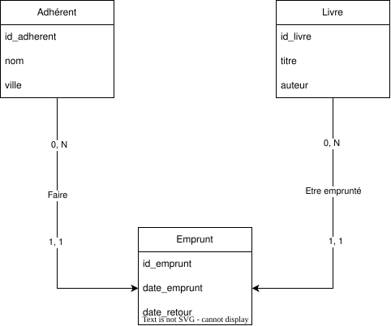

# BiblioTech

Catalogue en ligne de la médiathèque de quartier **BiblioTech**, réalisé avec Symfony

Les adhérents peuvent parcourir les livres, les filtrer, consulter la fiche d'un livre et savoir s'il reste un exemplaire disponible.

## Technologies

- PHP 8.4 / Symfony 8.1 (`-webapp`)
- Doctrine ORM et migrations
- Twig
- MySQL
- Fixtures et Faker

---

## Modélisation

### Règles de gestion

- La médiathèque gère des **livres** : titre, auteur, genre, année de parution, résumé (facultatif), couverture (facultative) et nombre d'exemplaires possédés.
- Les **adhérents** ont un nom, une ville (facultative) et un email (facultatif, mais unique).
- Un adhérent peut faire plusieurs **emprunts**, ou aucun. Un emprunt est fait par un seul adhérent et porte sur un seul livre.
- Un emprunt a une date d'emprunt et une date de retour. Tant que le livre n'est pas rendu, la date de retour est vide.
- Un livre peut avoir été emprunté plusieurs fois, ou jamais.

### Dictionnaire de données

| Code | Signification | Type | Taille | Contraintes |
| --- | --- | --- | --- | --- |
| id_livre | Identifiant du livre | Entier | | Identifiant, auto-incrémenté |
| titre | Titre du livre | Texte | 100 | Obligatoire |
| auteur | Auteur du livre | Texte | 100 | Obligatoire |
| genre | Genre du livre | Texte | 50 | Obligatoire |
| annee | Année de parution | Entier | | Obligatoire |
| resume | Résumé du livre | Texte long | | Facultatif |
| couverture | URL de l'image de couverture | Texte | 255 | Facultatif |
| exemplaires | Nombre d'exemplaires possédés | Entier | | Obligatoire |
| id_adherent | Identifiant de l'adhérent | Entier | | Identifiant, auto-incrémenté |
| nom | Nom de l'adhérent | Texte | 50 | Obligatoire |
| ville | Ville de l'adhérent | Texte | 50 | Facultatif |
| email | Email de l'adhérent | Texte | 100 | Facultatif, unique |
| id_emprunt | Identifiant de l'emprunt | Entier | | Identifiant, auto-incrémenté |
| dateEmprunt | Date et heure de l'emprunt | Date/heure | | Obligatoire |
| dateRetour | Date et heure du retour | Date/heure | | Facultatif (vide tant que le livre n'est pas rendu) |

### MCD



### MLD

```
ADHERENT (id_adherent, nom, ville, email)
LIVRE    (id_livre, titre, auteur, genre, annee, resume, couverture, exemplaires)
EMPRUNT  (id_emprunt, dateEmprunt, dateRetour, #id_adherent, #id_livre)
```

- Clés primaires : `id_adherent`, `id_livre`, `id_emprunt`.
- Clés étrangères : `#id_adherent` vers `ADHERENT` et `#id_livre` vers `LIVRE`, toutes deux `NOT NULL`.
- `dateRetour` accepte `NULL` (livre pas encore rendu).
- `email` est unique et accepte `NULL`.